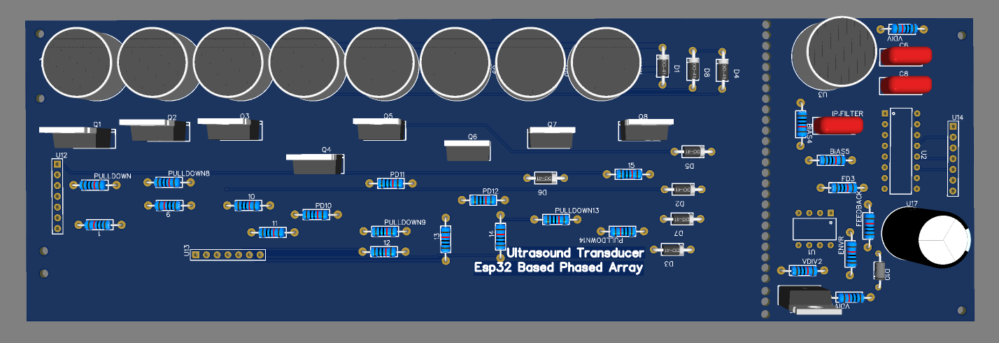

# 8-TX/1-RX Ultrasonic Array for Calibrated Ranging and Raw-Waveform Research

This repository contains a low-cost air-coupled ultrasonic sensing platform built around an ESP32, eight nominal 40-kHz transmitters, one receiver, a TL072 analog front end, a Schottky envelope detector, and an MCP3008 ADC.

The current hardware and firmware support sequential multi-transmitter ranging and raw/envelope capture. The project is developing toward calibrated angle-range sensing. Simultaneous phased-array transmission, general 2-D imaging, and deployment-grade material recognition are not yet validated.



## Current verified result

A controlled raw-waveform audit used four 50.0-cm sessions recorded on 2026-08-29 for wood, wall, plastic, and glass. The sessions contain 2170 captures over 31 electronic angles from -15 to +15 degrees, with 10--20 repeats per angle. Offline processing found 24.7--38.4 dB mean audited echo SNR and a repeatable uncorrected range bias of +12.68 +/- 0.54 cm. The true 50.0-cm distance was confirmed independently; the bias is consistent with the recorded 24-cycle burst and beam/channel delay budget.

This result demonstrates a useful calibration baseline. It is not a claim of absolute range accuracy, full-waveform 2-D reconstruction, or generalization to unseen objects/materials. Selected distance, imaging, timing, and classification result files are available under [`results/`](results/).

## Repository contents

- `html_logging.ino`: ESP32 Wi-Fi calibration dashboard and sequential scanner.
- `ultrasonic_shape_rudder.ino`: alternative ESP32 firmware with placeholder network credentials.
- `shape_plotter.py`: legacy serial plotting utility; update its port and input format before use.
- `unity/`: Unity console that draws the transmit beam, replays the recorded
  angle/range sessions as a sector image, and reads the ESP32 dashboard.
- `hardware/`: TX/RX circuit images and PCB-related assets.
- `data/`: supporting project images and waveform-related assets.
- `results/`: selected distance, 2D imaging, timing, and classification exports with provenance and limitations.
- `requirements.md`: current hardware/software requirements.

## Hardware architecture

| Block | Component | Role |
|---|---|---|
| Controller | ESP32-WROOM | TX control, SPI acquisition, Wi-Fi dashboard |
| ADC | MCP3008 | 10-bit envelope acquisition |
| Receiver | TCT40-16R | Common acoustic receiver |
| Transmitters | 8 x TCT40-16T | Independently switched nominal 40-kHz sources |
| RX amplifier | TL072 | Analog gain and conditioning |
| Envelope detector | 1N5819 and RC network | Converts received carrier to envelope |
| TX switches | 8 x IRLZ44N | Low-side channel switching |

The TX and RX elements are physically separated, so final ranging should use bistatic path geometry rather than assuming a colocated sensor.

## Safety and credential hygiene

Never commit real Wi-Fi credentials. Both firmware examples now contain placeholders. Before flashing `html_logging.ino`, set `WIFI_SSID` and `WIFI_PASSWORD` locally. If the previously committed password was real, rotate it immediately; removing it from the latest file does not remove it from Git history.

## Quick start

1. Clone this repository:

   ```bash
   git clone https://github.com/saadw50/ultrasound-phased-array-imaging.git
   cd ultrasound-phased-array-imaging
   ```

2. Install Espressif ESP32 board support in Arduino IDE.
3. Set local Wi-Fi credentials in the firmware without committing them.
4. Confirm the pin map and 12-V analog/TX supply before powering the board.
5. Flash one firmware sketch at a time; do not compile both sketches as one Arduino project.
6. Use Serial Monitor at 115200 baud and open the reported dashboard address.
7. Keep acquisition settings fixed within an experiment and preserve the CSV metadata.

## Pin mapping

### ESP32 to TX array

| TX | GPIO |
|---|---:|
| TX1 | 13 |
| TX2 | 12 |
| TX3 | 14 |
| TX4 | 27 |
| TX5 | 26 |
| TX6 | 25 |
| TX7 | 33 |
| TX8 | 32 |

### ESP32 to MCP3008

| Signal | GPIO |
|---|---:|
| CS | 5 |
| SCK | 18 |
| MISO | 19 |
| MOSI | 23 |
| VDD/VREF | 3.3 V |

## Unity phased-array console

[`unity/`](unity/) contains a Unity front end for this platform. It is a
visualisation and forward-modelling tool, not an additional measurement claim.

It draws four instrument panels: the 2-D acoustic field in front of the
aperture, the transmit beam pattern in decibels, a B-mode sector image, and the
per-channel delay schedule. It runs from recorded data, from a forward model, or
from a live ESP32 dashboard link, and it needs no scenes, prefabs, materials or
shaders — one component builds everything it draws.

The beamforming defaults are ported from `ultrasonic_shape_rudder.ino`, so the
simulated beam matches the delays the firmware actually emits, and the range
axis reproduces the exported CSV values exactly.

The console makes the array's known limitations measurable rather than
decorative. With a 17 mm pitch at 40 kHz the element spacing is 1.96
wavelengths, so grating lobes sit at ±30.7° at broadside; steering to +15° moves
one of them to **-14.5°, inside the ±15° sector the recorded sessions sweep**. A
reflector at +20°, outside the sweep entirely, produces its strongest response
near -10°. It also shows that the Rayleigh distance is 40.8 cm, so the audited
50.0 cm target is only just in the far field, and that the 240 MHz delay grid
contributes 0.03° of carrier phase error, which is not what limits the array.

See [`unity/README.md`](unity/README.md) for setup, the data pipeline and the
full list of limitations.

## Processing and research roadmap

1. Define the timing origin and apply the measured burst/delay correction.
2. Validate that correction at multiple known distances.
3. Measure per-channel TX amplitude and relative delay.
4. Collect independent sessions, object instances, distances, yaw angles, and nonzero backgrounds.
5. Report MAE, median absolute error, confidence intervals, detection probability, false alarms, and angular/range resolution.
6. Use leave-one-session/object-out splits for the separate material classification branch.
7. Quantify grating lobes caused by the approximately 17-mm pitch at 40 kHz instead of smoothing them away.

## Known limitations

- Current firmware is sequential TX scanning, not simultaneous phased-array beamforming.
- One receiver does not support conventional multi-channel receive beamforming.
- The MCP3008 envelope path does not preserve the received 40-kHz carrier phase.
- TX/RX separation creates bistatic geometry.
- Indoor multipath and threshold selection affect long-range results.
- The current evidence does not establish deployment-grade accuracy or general material recognition.

## License and contact

This project is released under the [MIT License](LICENSE).

Maintainer: [Shad Ebny Wahid](https://github.com/saadw50)

Jamalpur Science and Technology University, Bangladesh

Corresponding paper email: `s23111212@bsfmstu.ac.bd`
