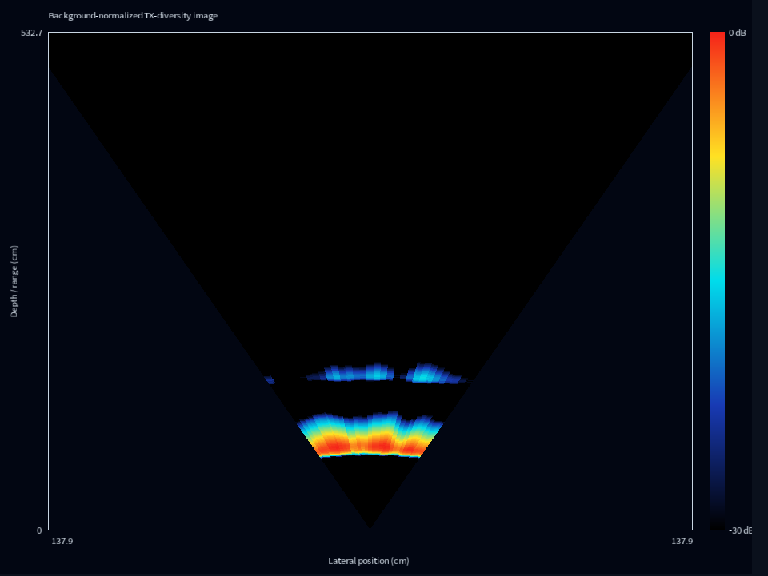
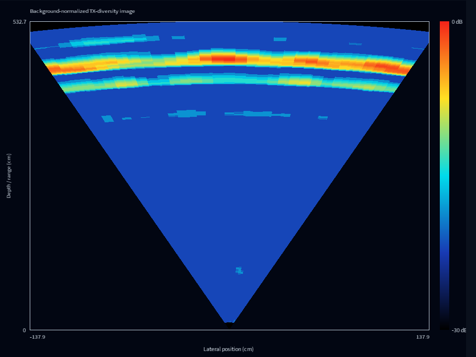
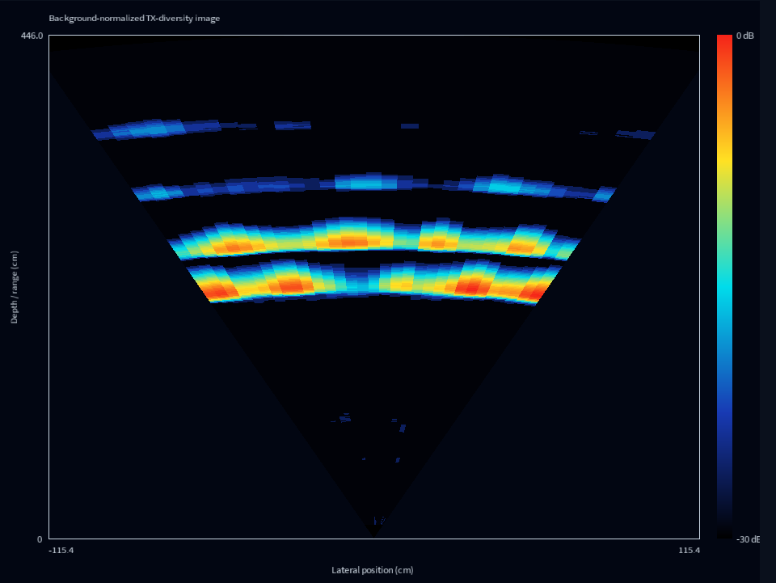
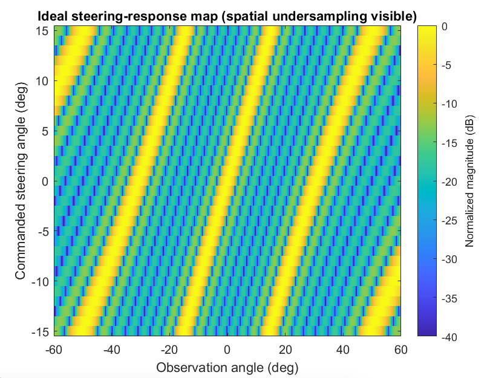

# 2D visualization gallery

This gallery contains three historical USB2D envelope-sector displays and one theoretical steering-response map, cropped from selected project screenshots. Each PNG is an exact rectangular crop: no data were redrawn, resized, filtered, smoothed, or recolored. Axes and color scales are retained as recorded. The controls and desktop have been removed from the images; relevant source settings are recorded below and in [manifest.json](manifest.json).

**These are uncalibrated visualization examples and a separate simulation.** They do not establish absolute range accuracy, unique physical bearing, full-waveform 2D reconstruction, multiple-object detection, or measured phased-array performance. The operator-entered distances were not independently verified for these screenshots.

## Near-range envelope response

The original interface contains a 75-cm known-distance input, while its status reports a peak at 88.9 cm and a commanded angle of -9 degrees. The +13.9-cm difference is relative to that entered value, not an independently verified error measurement. The sector documents the normalized response display.

Source settings: USB2D-2.0.0; -15 to +15 degrees in 1-degree steps; FULL8/LEFT4/RIGHT4; one repeat per angle/mode; 8 burst cycles; 500-us blanking; 30000-us RX window; 50-us range bins; zero TOF offset; SINGLE ADC mode.

## Far-response envelope sector

The original interface contains a 500-cm known-distance input and reports a strongest response at 466.8 cm and a commanded angle of 0 degrees. The difference from the entered value is -33.2 cm. The physical scene and target distance were not independently established during this review, so this is not validated 5-m ranging.

Source settings: USB2D-2.0.0; -15 to +15 degrees in 1-degree steps; FULL8/LEFT4/RIGHT4; two repeats per angle/mode; 8 burst cycles; 500-us blanking; 30000-us RX window; 50-us range bins; zero TOF offset; SINGLE ADC mode.

## Multiple response bands

Several response bands appear in this historical display. Its status reports a strongest response at 222.4 cm and a commanded angle of 9 degrees. The known-distance field contains 500 cm, beyond the displayed 446-cm axis. The scene and the physical sources of the bands remain unresolved; they cannot be counted as separately detected objects.

Source settings: USB2D-2.0.0; -15 to +15 degrees in 1-degree steps; FULL8/LEFT4/RIGHT4; one repeat per angle/mode; 8 burst cycles; 500-us blanking; 25000-us RX window; 50-us range bins; zero TOF offset; SINGLE ADC mode.

## Theoretical steering-response map

This is the ideal normalized array-factor model from the MATLAB simulation, using eight transmitters, a 40-kHz carrier, 17-mm pitch, and 346.75-m/s sound speed. It maps commanded steering angle against observation angle and illustrates spatial undersampling. It is not a measured acoustic image.

Only the steering-response panel was extracted from the original four-window MATLAB screenshot. Its local source is `Ultrasonic_Phased_Array_MATLAB_Supervisor_Package/Ultrasonic_Phased_Array_Q1_Simulation.m`. The model was not rerun for this cropping task.

## Interpretation and provenance

The three USB2D plots belong to the legacy envelope/bin visualization workflow. They are separate from GPIO35 raw-waveform classification, later per-element 2DIMG captures, and paired raw/envelope firmware. A commanded scan angle is not an independently measured physical target bearing.

The Processing renderer subtracts background bin medians, scales responses relative to background variation, takes the maximum score across FULL8/LEFT4/RIGHT4, and normalizes the resulting sector display. Timing origin, bistatic geometry, multipath, calibration, and spatial aliasing remain limitations. Exact screenshot-to-session and historical source-version mappings were not recovered.

[manifest.json](manifest.json) records original screenshot filenames, source and output SHA-256 hashes, crop rectangles, dimensions, visible acquisition settings, and exact pixel-comparison results. The full screenshots remain in the local archive. Dates in image filenames are inherited screenshot dates, not independently verified measurement dates. Cropping and pixel checks were completed on 2026-11-16.

See the [results notes](../../README.md) for the scope of the existing exports, or return to the [project README](../../../README.md).
